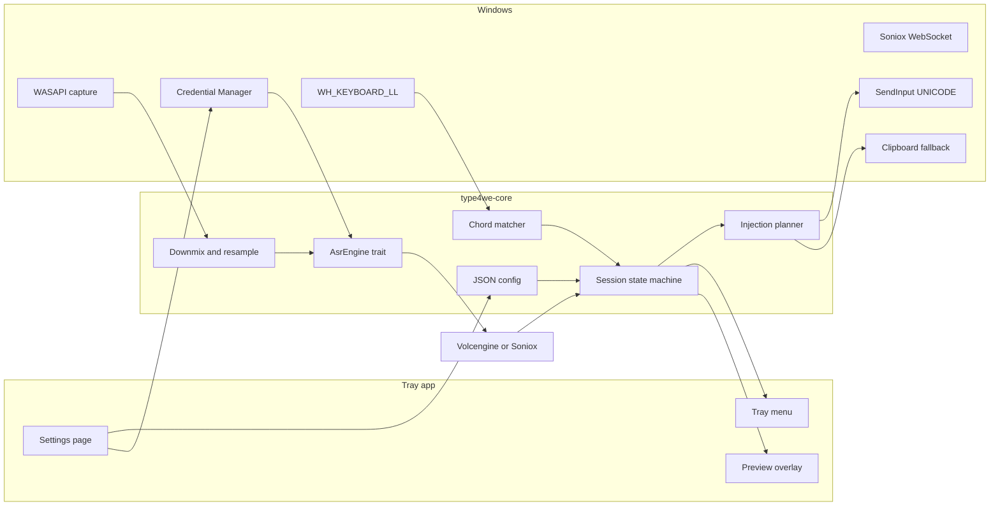

# Architecture

[中文](../zh/architecture.md)

Type4We is a tray-resident [Tauri 2](https://v2.tauri.app/) app. Rust owns the hotkey, microphone, recognizer, session, and text injection. The settings window is a small static page (HTML, CSS, and JavaScript) loaded by the WebView.

Platform calls sit behind `cfg(windows)`. The crate `type4we-core` has no Win32 dependency, so the session machine, config parser, resampler, hotkey chord matcher, and Soniox framing tests run on Linux.

## Modules

| Module | Role |
| --- | --- |
| `hotkey` | Parses bindings such as `RAlt` and `Ctrl+Win`. Decides the press/release edge and which keys to swallow so Right Alt does not open menus and the Windows key does not open Start. |
| `audio` | Mono downmix and a streaming linear resampler. WASAPI itself is in the app crate, on a thread that owns the stream (`cpal::Stream` is not `Send`). |
| `asr` | `AsrEngine` / `AsrWriter` / `AsrReader`. Volcengine is the default engine; Soniox is the other one. A local engine implements the same traits and reports its own sample rate. |
| `session` | Idle → Starting → Listening → Finalizing → Idle. Final text is injected as it arrives. Events carry a session id so a late message from the previous take is ignored. |
| `inject` | Plans UTF-16 unicode strokes. Newlines become Enter. The Windows side sends them with `KEYEVENTF_UNICODE`. |
| `config` | Load and save `%APPDATA%\Type4We\config.json`. Strips `apiKey` and the other secret field names. Keeps unknown `tf_*` groups. |
| `secrets` | `SecretStore`. Windows uses Credential Manager target `com.type4we.grouped:<account>:<field>`. |
| `ui` | Settings and the overlay. The tray is created in Rust. |

## Session

Push-to-talk maps key-down to start and key-up to stop. Toggle maps each press to start or stop and ignores the release. While listening, each newly final token is injected immediately. On stop, the driver sends Soniox `{"type":"finalize"}` and then an empty text frame (an empty binary frame does not end the stream), waits up to five seconds, and injects any remaining non-final text once.

## ASR plug

`create_engine` accepts `volcano` and `soniox`. The driver asks the engine for `AudioRequirements` (16 kHz mono PCM; Volcengine asks for 200 ms frames) and resamples whatever WASAPI delivered. Adding a provider means a new `AsrEngine` and a config block. It does not mean a new hotkey or injection path. See [ADR 0002](adr/0002-cloud-asr.md) and [ADR 0005](adr/0005-volcengine-default.md).
