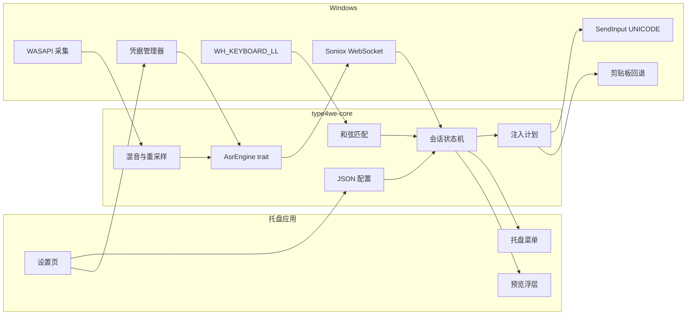

# 架构

[English](../en/architecture.md)

Type4We 是常驻托盘的 [Tauri 2](https://v2.tauri.app/) 应用。热键、麦克风、识别、会话和文字注入都在 Rust 里。设置窗口是 WebView 加载的一小页静态 HTML、CSS 和 JavaScript。

平台调用放在 `cfg(windows)` 后面。`type4we-core` 不依赖 Win32，所以会话状态机、配置解析、重采样、热键和弦判断和 Soniox 组帧测试可以在 Linux 上跑。

## 模块

| 模块 | 职责 |
| --- | --- |
| `hotkey` | 解析 `RAlt`、`Ctrl+Win` 这类绑定。判断按下/松开，并决定吞掉哪些键，避免右 Alt 打开菜单、Win 键打开开始菜单。 |
| `audio` | 单声道混音和流式线性重采样。WASAPI 在应用 crate 里，由单独的线程持有流（`cpal::Stream` 不是 `Send`）。 |
| `asr` | `AsrEngine` / `AsrWriter` / `AsrReader`。目前只有 Soniox。以后的本地引擎实现同一组 trait，并自己声明采样率。 |
| `session` | 空闲 → 启动 → 聆听 → 收尾 → 空闲。已确定的文字到了就注入。事件带会话 id，上一轮迟到的消息会被丢掉。 |
| `inject` | 把文字规划成 UTF-16 按键。换行变成 Enter。Windows 侧用 `KEYEVENTF_UNICODE` 发送。 |
| `config` | 读写 `%APPDATA%\Type4We\config.json`。剥掉 `apiKey` 等密钥字段。未知的 `tf_*` 分组会保留。 |
| `secrets` | `SecretStore`。Windows 使用凭据管理器，目标名是 `com.type4we.grouped:<账户>:<字段>`。 |
| `ui` | 设置页和浮层。托盘菜单在 Rust 里创建。 |

## 会话

按住说话把按下映射成开始、松开映射成停止。切换模式每次按下开始或停止，忽略松开。聆听期间，每段新确定的 token 会立刻注入。停止时，驱动先向 Soniox 发送 `{"type":"finalize"}`，再发一个空文本帧（空的二进制帧不会结束会话），最多再等五秒，然后把剩余的非最终文字注入一次。

## 识别插件

`create_engine("soniox")` 是目前唯一的工厂分支。驱动向引擎询问 `AudioRequirements`（16 kHz、单声道、PCM s16le），再把 WASAPI 送来的音频重采样过去。加一家供应商就是新的 `AsrEngine` 和一块配置，不用改热键或注入。见 [ADR 0002](adr/0002-cloud-asr.md)。
